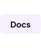

<a href="https://knight.metatable.dev"></a><a href="https://github.com/RAMPAGELLC/knight/releases"></a>
<hr>

Knight is a robust and modular Roblox game framework designed to help you organize your projects efficiently. It provides optional tools to enhance your workflow—but tools are **not required** to use Knight.

---

## 🚀 Getting Started

You can start using Knight in three ways:

### Option 1: Clone via Git

```bash
git clone https://github.com/RAMPAGELLC/knight.git
```

### Option 2: Using Wally

Add `knight = "vq9o/knight@latest"` to `wally.toml` then run `wally install`.

---

## Module tables

Frozen tables and empty tables without a metatable are exposed as returned and are not
initialized as services. To preserve a non-empty data table, set `Standalone = true`
on it or tag its ModuleScript `KnightStandalone`.

Standalone modules remain available through their folder and `GetService`, but Knight does not inject fields or run their
`Init` and `Start` methods. An otherwise empty table can opt into service behavior by
returning `{ Standalone = false }`.

---

## 🛠 Tools (Optional)

These tools are **optional** and exist to improve your workflow with Knight.

### ✅ Knight VSC Extension

Create and autofill Knight services in VS Code.

-   [Marketplace](https://marketplace.visualstudio.com/items?itemName=MetaGames.vsc-knight)
-   [GitHub](https://github.com/RAMPAGELLC/vsc-knight)

---

## 🤝 Contribute
We welcome contributions from everyone!
-   [Contribute to Documentation](https://knight.metatable.dev/contribution/documentation)
-   [Contribute to Framework](https://knight.metatable.dev/contribution/framework)

Simply make your edits in a Fork and open a PR!
---

## 📄 License
[MIT License](https://github.com/RAMPAGELLC/knight/blob/main/LICENSE)
